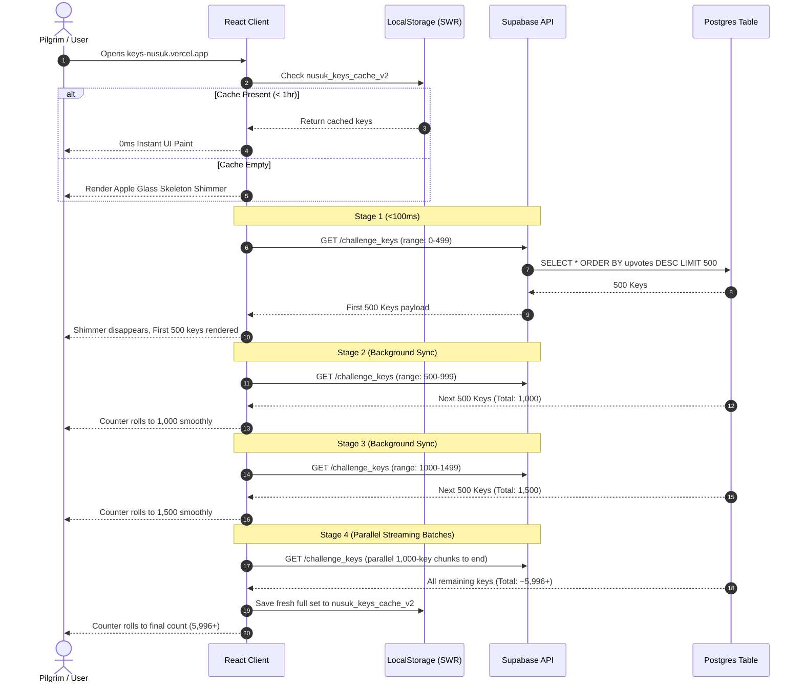

# 🏛️ Nusuk Keys Architecture & Engineering Deep Dive

This document details the architectural decisions, data pipeline, performance strategies, and user interface paradigms implemented in **Nusuk Keys (مفاتيح نسك)**.

---

## 1. ⚡ 4-Stage Progressive Hydration Pipeline

Fetching 6,000+ records over a standard HTTP connection can result in a slow Time to Interactive (TTI) or an uncomfortable blank loading screen if attempted in a single blocking payload. 

To solve this, Nusuk Keys implements an adaptive **4-stage progressive hydration pipeline** in `src/app/page.tsx`:



### Key Performance Benefits:
1. **First Contentful Paint (FCP)**: Delivered in **<100ms** because Stage 1 requests only 500 rows.
2. **Zero Layout Shift (CLS = 0)**: The container layout and skeleton dimensions precisely match loaded cards.
3. **Optimistic Updates**: The animated rolling counter (`NumberCounter.tsx`) handles increments smoothly without freezing frame rates.

---

## 2. 💾 Local-First SWR Caching

When a user revisits the site, waiting even 100ms is unnecessary. We utilize a Stale-While-Revalidate (SWR) pattern via `localStorage`:
- **Cache Key**: `nusuk_keys_cache_v2`
- **Time-to-Live (TTL)**: 3,600,000 ms (1 hour)
- **Lifecycle**:
  1. On mount, if valid cache exists, hydrate memory immediately (0ms).
  2. Silently execute Stage 1 to check for freshly added keys.
  3. Seamlessly reconcile any new submissions at the head of the list.

---

## 3. 🎨 Apple Glassmorphic Design System

The visual language follows the Human Interface Guidelines from Apple:
- **Surface Hierarchy**:
  - Background: Ultra-deep zinc `#09090b`.
  - Glass Containers: Semi-transparent zinc `rgba(24, 24, 27, 0.6)` with backdrop blur `backdrop-blur-xl` and 1px border `border-zinc-800/80`.
  - Active Accents: Emerald Green (`#10b981`) for verification, warm Amber (`#f59e0b`) for sacred texts.
- **Spring Physics**:
  - Implemented using `framer-motion` spring dynamics:
    `{ type: "spring", stiffness: 400, damping: 30 }`
- **Procedural Haptic Audio**:
  - Instead of shipping heavy `.mp3` audio files, `src/lib/audio.ts` uses the browser's native **Web Audio API** to synthesize click and success sound waves on the fly:
    - *Click*: 800Hz triangle oscillator decaying in 40ms.
    - *Success*: Arpeggiated dual-frequency chime (523Hz + 659Hz) decaying with sweet resonance.

---

## 4. 🕌 Bilingual Typography & RTL Layouts

Arabic is a first-class citizen in Nusuk Keys:
- **Font Stack**:
  - English: `Inter`, system sans-serif.
  - Arabic Standard: `Amiri`, Cairo, system Arabic.
  - Sacred Quran/Hadith: Handcrafted **Nasta'liq** font family (`font-nastaliq`, `Noto Nastaliq Urdu`, `Jameel Noori Nastaleeq`) with generous vertical line height (`leading-[2.8] - leading-[3]`) to avoid clipping diacritics (tashkeel).
- **RTL Mirroring**:
  - Bidirectional search bar layouts.
  - Modal close buttons dynamically placed on the left (`left-5`) in RTL mode to prevent collision with top-right icons.
  - Mirrored badges and card alignments.

---

## 5. 🛡️ Client & Server Security Architecture

```
[User Input: NG-XXXX]
        │
        ▼
[1. Client Sanitizer] ──> Auto-uppercase, strip characters not in [A-Z0-9_-]
        │
        ▼
[2. Regex Guard] ───────> Matches ^NG-[A-Za-z0-9_-]+$ (Length 5 - 50)
        │
        ▼
[3. Rate Limiter] ──────> Token Bucket: Max 1 key / 15 seconds per client
        │
        ▼
[4. Uniqueness Check] ──> PostgREST query: SELECT id FROM challenge_keys WHERE code = $1
        │                  └── If exists: Shake error animation, reject submission
        ▼
[5. PostgREST INSERT] ──> Protected by Postgres Row Level Security (RLS)
        │
        ▼
[6. Database Commit] ───> Code stored, broadcasted via Supabase Realtime
```

---

## 6. 📱 PWA & SEO Specifications

- **Manifest**: Located at `src/app/manifest.ts`, configuring `display: standalone`, `theme_color: #09090b`, and `background_color: #09090b`.
- **Search Console**: Verified using `googlea2294fd447f1f41b.html`.
- **Robots & Sitemap**: Dynamically generated at `/robots.txt` and `/sitemap.xml`.
- **AI Agent Context**: Provided at `/llms.txt` for clean consumption by LLMs and web agents.
- **Social Metadata**: 1200×630 custom-crafted OpenGraph and Twitter cards rendered at `https://keys-nusuk.vercel.app/og-image.png`.
