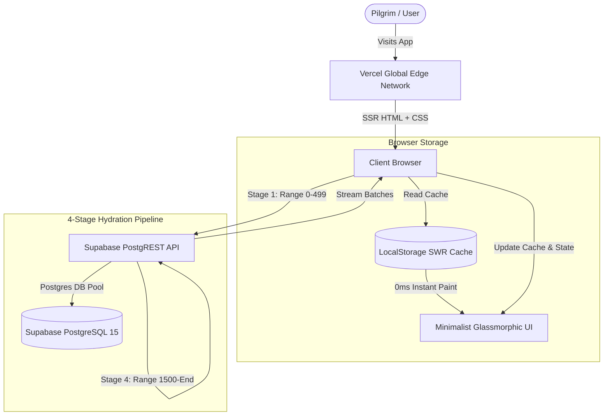

<div align="center">

# 🕋 Nusuk Keys (مفاتيح نسك)

**The Community-Powered Directory for Nusuk Umrah Challenge Keys**

[](https://keys-nusuk.vercel.app)
[](https://nextjs.org)
[](https://react.dev)
[](https://www.typescriptlang.org)
[](https://tailwindcss.com)
[](https://supabase.com)
[](LICENSE)

<br />

A high-performance, modern progressive web application designed to help pilgrims worldwide discover, verify, and share referral keys (`NG-...`) for challenges in the official **Nusuk (نسك)** mobile app. Built with Next.js 14, Supabase, Tailwind CSS, and Framer Motion.

[Explore Live App](https://keys-nusuk.vercel.app) · [View Architecture](ARCHITECTURE.md) · [Security Model](SECURITY.md) · [Contributing Guide](CONTRIBUTING.md) · [Report Issue](https://github.com/RanaZaid26194/nusuk_keys/issues)

</div>

---

## ⚡ Highlights & Key Capabilities

- **⚡ 4-Stage Progressive Hydration Pipeline**:
  - **Stage 1 (<100ms)**: Renders the first 500 challenge keys instantly upon load.
  - **Stage 2 (Background Sync)**: Fetches up to 1,000 keys silently.
  - **Stage 3 (Background Sync)**: Expands the list to 1,500 keys.
  - **Stage 4 (Parallel Streaming)**: Hydrates the full catalog of **7,000+ keys** without ever locking the UI thread.
- **💾 Zero-Latency Local Caching (SWR)**: Utilizes `localStorage` with versioned cache busting (`nusuk_keys_cache_v2`). Return visits render in **0ms** from local storage while syncing fresh changes in the background.
- **🎨 Modern Minimalist Glassmorphic Design**:
  - Dark zinc glassmorphic surfaces (`bg-zinc-900/60`, `backdrop-blur-xl`).
  - Smooth rounded squircles and micro-badges.
  - Fluid spring physics powered by `framer-motion` (stiffness: 400, damping: 30).
  - Web Audio API procedural sound synthesizers generating zero-latency mechanical clicks and soft chime tones on user interactions.
- **🕌 Native Bi-directional RTL & Sacred Calligraphy**:
  - Instant one-tap switcher between **English (LTR)** and **العربية (RTL)** with mirrored layouts.
  - Daily Quranic Ayah banner rotating automatically with live API integration and verified offline fallback.
  - Platform-aware Ayah end marker engine (`۝`): precision composite centering on iOS WebKit while preserving native HarfBuzz ligatures on Desktop and Android.
  - Handcrafted **Nasta'liq** calligraphy style typography for Quranic Ayahs (*Surah Al-Ma'idah 5:2*) and Hadith (*Sahih Muslim 2699*), rendered with vertical breathing room.
- **🛡️ Multi-Tier Security, Anti-Abuse & Moderation**:
  - Client & database level Regex sanitization: `^NG-[A-Za-z0-9_-]+$`.
  - Dedicated pilgrim **Report Modal** with native mailto routing and instant clipboard copy for rapid invalid key removal.
  - Token-bucket client-side rate limiting (prevents rapid submission spam).
  - Real-time duplicate key detection against Supabase Postgres with animated shake alerts.
  - Postgres Row-Level Security (RLS) guaranteeing tamper-proof public read/insert permissions.
- **📱 PWA & Mobile Installability**:
  - Fully compliant Progressive Web App with `manifest.json`, high-resolution iOS touch icons, and Android standalone display mode.
- **🔍 SEO & LLM Ready**:
  - Dynamic `sitemap.xml`, `robots.txt`, and crawler-friendly `llms.txt`.
  - Rich 1200×630 OpenGraph and Twitter cards for social sharing.
  - Integrated Vercel Web Analytics and Speed Insights for real-time Core Web Vitals monitoring.

---

## 🏗️ Architecture Overview



For an exhaustive explanation of the data flow, state management, and audio synthesis, see [ARCHITECTURE.md](ARCHITECTURE.md).

---

## 🗄️ Database Schema & RLS Policies

Run this in your **Supabase SQL Editor** to initialize the table, indexes, and Row Level Security policies:

```sql
-- 1. Create table for challenge keys
CREATE TABLE IF NOT EXISTS challenge_keys (
    id UUID PRIMARY KEY DEFAULT gen_random_uuid(),
    code VARCHAR(50) UNIQUE NOT NULL,
    upvotes INT DEFAULT 1,
    downvotes INT DEFAULT 0,
    copies_count INT DEFAULT 0,
    is_active BOOLEAN DEFAULT TRUE,
    created_at TIMESTAMP WITH TIME ZONE DEFAULT NOW(),
    last_verified_at TIMESTAMP WITH TIME ZONE DEFAULT NOW()
);

-- 2. Create optimized compound indexes for sorting and filtering
CREATE INDEX IF NOT EXISTS idx_challenge_keys_active 
ON challenge_keys (is_active, upvotes DESC, created_at DESC);

CREATE INDEX IF NOT EXISTS idx_challenge_keys_code 
ON challenge_keys (code);

-- 3. Enable Row Level Security (RLS)
ALTER TABLE challenge_keys ENABLE ROW LEVEL SECURITY;

-- 4. RLS Policies
-- Allow anyone to read active keys
CREATE POLICY "Allow public read active keys" 
ON challenge_keys FOR SELECT 
USING (is_active = true);

-- Allow anyone to submit a new key conforming to the NG format
CREATE POLICY "Allow public submit new keys" 
ON challenge_keys FOR INSERT 
WITH CHECK (code ~ '^NG-[A-Za-z0-9_-]+$');

-- Allow community voting and copy count incrementing
CREATE POLICY "Allow voting updates" 
ON challenge_keys FOR UPDATE 
USING (true);

-- 5. Enable Realtime Publications
ALTER PUBLICATION supabase_realtime ADD TABLE challenge_keys;
```

---

## 🚀 Quick Start & Local Setup

### Prerequisites
- Node.js 18.17+ or Node.js 20+
- npm or pnpm or bun

### 1. Clone the Repository
```bash
git clone https://github.com/RanaZaid26194/nusuk_keys.git
cd nusuk_keys
```

### 2. Install Dependencies
```bash
npm install
```

### 3. Setup Environment Variables
Create a `.env.local` file in the root directory:
```env
NEXT_PUBLIC_SUPABASE_URL=https://dttwxygghtdxokcebwta.supabase.co
NEXT_PUBLIC_SUPABASE_ANON_KEY=your_supabase_anon_key_here
NEXT_PUBLIC_SITE_URL=http://localhost:3000
```

> [!NOTE]
> If run without Supabase credentials, the application automatically falls back to an interactive local demo state with client storage persistence.

### 4. Start Development Server
```bash
npm run dev
```

Visit [http://localhost:3000](http://localhost:3000) to view the application.

### 5. Build for Production
```bash
npm run build
npm start
```

---

## 📂 Project Structure

```
nusuk_keys/
├── public/                       # Static assets & verification files
│   ├── favicon.ico               # 32x32 multi-size favicon
│   ├── icon.svg                  # Scalable vector icon
│   ├── apple-icon.png            # 180x180 iOS home screen icon
│   ├── og-image.png              # 1200x630 high-res OpenGraph card
│   ├── twitter-image.png         # 1200x630 Twitter card
│   ├── robots.txt                # Search engine crawler policies
│   ├── llms.txt                  # Context-optimized crawler file for AI agents
│   └── googlea2294fd447f1f41b.html # Google Search Console ownership verification
├── src/
│   ├── app/
│   │   ├── layout.tsx            # Global layout, fonts, meta tags & Vercel analytics
│   │   ├── page.tsx              # Core app container, 4-stage hydration pipeline
│   │   ├── globals.css           # Tailwind custom utilities, Nasta'liq font rules
│   │   ├── manifest.ts           # PWA manifest generator
│   │   ├── robots.ts             # Dynamic robots.txt generator
│   │   └── sitemap.ts            # Dynamic XML sitemap generator
│   ├── components/
│   │   ├── Header.tsx            # Glassmorphic header, language switch, CTA
│   │   ├── Hero.tsx              # Value proposition, live statistics, daily ayah banner
│   │   ├── DailyAyah.tsx         # Daily rotating Quranic banner with live API & fallback
│   │   ├── KeyGrid.tsx           # Search, filters, glass shimmer & card grid
│   │   ├── KeyCard.tsx           # Interactive key card, copy action, up/down voting
│   │   ├── SubmitModal.tsx       # Share key dialog with live validation & haptics
│   │   ├── InfoModal.tsx         # "Why Share?" modal with Nastaliq sacred quotes
│   │   ├── NumberCounter.tsx     # Animated rolling counter for key totals
│   │   └── Footer.tsx            # Sadaqah Jariyah footer & navigation links
│   ├── data/
│   │   ├── ayahs.json            # Curated verified offline fallback ayahs
│   │   └── ayahLimits.json       # Character bounds for daily ayah validation
│   └── lib/
│       ├── audio.ts              # Web Audio API procedural sound synthesizer
│       ├── dailyAyah.ts          # Deterministic daily ayah resolver & cache
│       ├── security.ts           # Code sanitization, validation & rate limiting
│       ├── supabase.ts           # Supabase client instantiation
│       ├── translations.ts       # Bilingual English & Arabic dictionaries
│       ├── types.ts              # TypeScript interfaces & database schemas
│       └── utils.ts              # Utility helpers
├── ARCHITECTURE.md               # Technical architecture & hydration benchmark docs
├── CONTRIBUTING.md               # Contribution and coding standards
├── SECURITY.md                   # Security model & RLS threat boundaries
├── CHANGELOG.md                  # Release notes & version changelog
└── LICENSE                       # MIT License
```

---

## 🤝 Contributing & Community Support

Contributions, feedback, and feature suggestions are warmly welcomed! As a community-driven project, help from developers and pilgrims worldwide makes this service better for everyone.

Ways you can contribute:
- **Translations**: Help translate the interface into languages spoken by pilgrims worldwide (Urdu, Indonesian, Turkish, Malay, French, etc.).
- **Feature Enhancements**: UI polish, accessibility improvements, and performance optimizations.
- **Reporting Issues**: Found a bug or an edge case? Please open an issue on GitHub.

To get started:
1. **Fork** the repository.
2. Create a branch (`git checkout -b feature/your-feature`).
3. Commit your work (`git commit -m 'feat: describe your feature'`).
4. Push to the branch (`git push origin feature/your-feature`).
5. Open a **Pull Request**.

See [CONTRIBUTING.md](CONTRIBUTING.md) for full development guidelines.

---

## 🌍 Open-Source & Sadaqah Jariyah

This project was built with the singular intention of serving the global Umrah & Hajj community. Earning rewards and completing challenges in the Nusuk app should be accessible, seamless, and completely free of spam or ads.

> «وَتَعَاوَنُوا عَلَى الْبِرِّ وَالتَّقْوَىٰ»  
> *“And cooperate in righteousness and piety...”* — [Surah Al-Ma'idah 5:2]

> «وَاللَّهُ فِي عَوْنِ الْعَبْدِ مَا كَانَ الْعَبْدُ فِي عَوْنِ أَخِيهِ»  
> *“Allah helps His servant as long as the servant is helping his brother.”* — [Sahih Muslim 2699]

---

## 📄 License

Distributed under the **MIT License**. See [`LICENSE`](LICENSE) for more information.
